# Sơ đồ phân phối Agent × Skill — Wakii team

_Sơ đồ phân phối: agent nào sử dụng skill nào — 3 lớp routing (CHÍNH / BẮT BUỘC giai đoạn / THAM KHẢO). Nguồn: kit/skills (34) · repo skills (33) · kit/agents (32) — đối chiếu ls thật._

## 1. Sơ đồ tổng thể

```mermaid
flowchart TD
    subgraph AGENTS[Agents theo vai]
        CAP[captain — điều phối]
        FE[fe-dev + ui-dev — FE/UI]
        BE[be-dev — BE mixed-stack]
        QA[mason — QA/test]
        REV[code-reviewer — review]
        BA2[ba — nghiệp vụ]
        MOB[mobile-dev Flutter + mobile-developer RN]
        EXE[task-executor — thi công đa vai]
        E2E[e2e-runner — stack thật]
        GAPS[ECC on-demand: doc-updater · a11y-architect · perf · loop/harness · chief-of-staff defer]
    end
    subgraph KIT[22 kit skills]
        BA6[ba ×6: grilling · KB · confirm · questionnaire · authoring · teach-workspace]
        WF[team-workflow · story-workflow · writing-plans-linear · orca-superpowers · orca-bridge · session-handoff]
        QA_S[test-authoring · rule-authoring · rules-index · token-review · prompt-master · crew-recovery]
        FE_S[frontend-design · ui-ux-pro-max · figma · mock-prototype · fe-self-verify · tokens-workflow · i18n · electron-renderer]
        OPT[caveman · compress · ponytail · audit]
    end
    subgraph REPO[33 repo skills]
        FE_R[design-taste · web-guidelines · image-to-code · i18n-ui-layout]
        BE_R[api-contract · messaging-kafka · service-ops · contract-first · db-migrations · postgres/redis/docker/k8s · error-handling · hexagonal · latency]
        MOB_R[dart-flutter-patterns · flutter-code-review · rn-patterns · emulator ×2]
        INT[jira/linear ×2 · orca-jira/linear · per-workspace-env · plugin-authoring · orchestration]
        COD[10 ECC coding bổ sung]
    end
    FE --> FE_S & FE_R & OPT
    BE --> BE_R & INT
    QA --> QA_S & COD
    REV --> BE_R & COD & WF
    BA2 --> BA6 & WF
    MOB --> MOB_R & FE_S
    EXE --> FE_S & BE_R & QA_S
    E2E --> FE_R & COD
    GAPS -.on-demand.-> COD & INT
```

## 2. Ma trận phân phối chi tiết

| Agent | CHÍNH (pick 1/task) | BẮT BUỘC giai đoạn | THAM KHẢO |
|---|---|---|---|
| **fe-dev** | frontend-design hoặc ui-ux-pro-max (thiết kế mới) | fe-self-verify (trước DONE UI) · wakii-tokens-workflow (đụng màu) · i18n-ui-layout (đụng label) | dataviz · huashu-design |
| **ui-dev** | ui-ux-pro-max + frontend-design (compose ui-kit) | fe-self-verify · wakii-tokens-workflow · i18n-ui-layout | figma-implement-design |
| **be-dev** | be-api-contract (đổi API) · be-messaging-kafka (Kafka) · be-service-ops (Dockerfile/ports) | contract-first · database-migrations (đụng DB) · error-handling | senior-backend (generic) |
| **mason** | test-authoring (viết test RED có chủ đích) | be-api-contract/be-messaging-kafka/be-service-ops (test services/) | 10 ECC coding (pattern tham khảo) |
| **code-reviewer** | rules-index (glob diff → rules/ngôn ngữ) | be-api-contract/be-messaging-kafka/be-service-ops (review services/) | pr-test-analyzer (ECC — coverage PR) |
| **ba** | ba-grilling (hỏi CEO design tree) · ba-knowledge-base (tra/giữ KB) | ba-confirm-protocol (mọi trả lời kèm nguồn, cấm đoán) | ba-teach-workspace · ba-questionnaire (batch tuần) |
| **mobile-dev** | mobile-design (design thinking mobile) | dart-flutter-patterns (pattern Dart) · flutter-dart-code-review (review) | ui-ux-pro-max (Flutter stack) |
| **mobile-developer** | react-native-patterns (RN patterns) | senior-backend (offline-first/API BE) | mobile-design (design chung) |
| **task-executor** | theo task: FE → tokens/i18n · BE → 3 skill BE · test → test-authoring | rules-index (mọi file đụng) | — |
| **e2e-runner** | e2e-testing + verification-loop (ECC) | fe-self-verify (browser checks pattern) | — |
| **captain** | rules-index (glob diff) · token-review (cost) | crew-recovery (worker kẹt) · session-handoff (restart) | prompt-master (brief) |
| **ECC on-demand** | doc-updater (docs stale) · a11y-architect (a11y task) · performance-optimizer (perf) · loop-operator/harness-optimizer (automation ops) | opensource×3 (khi open-source) | chief-of-staff (DEFER) |

## 3. Nguyên tắc routing (giữ vững mọi agent)

- **Lớp CHÍNH**: mỗi task pick 1 — không dùng nhiều skill chính cùng lúc
- **Lớp BẮT BUỘC giai đoạn**: không phụ thuộc task — UI xong → fe-self-verify · đụng màu → tokens · đụng label → i18n
- **Lớp THAM KHẢO**: chỉ khi yêu cầu cụ thể
- **Mọi agent đụng file code**: đọc `rules/` theo glob TRƯỚC (rules-index) — rules là lớp ngang mọi agent, không thuộc routing 3 lớp
- **BA rule cốt lõi**: KHÔNG ĐOÁN — áp cho mọi agent giữ knowledge

## 4. Kho ECC on-demand (thư viện 71 agents — chưa hire)

doc-updater · a11y-architect · pr-test-analyzer · code-simplifier · performance-optimizer · loop-operator · harness-optimizer · opensource-forker/packager/sanitizer · chief-of-staff (DEFER) — hire qua `team-orch worker-start --agent <tên>` khi trigger xuất hiện.
